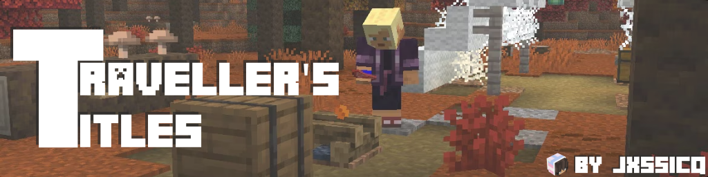

\

**Travellers Titles** is a lightweight, immersive client-side Minecraft Fabric mod that brings an RPG-style adventure feel to your exploration. Every time you step into a new biome, a cinematic popup title greets you, accompanied by custom audio cues and particles.

---

## ✨ Features

- **Cinematic Biome Popups:** Displays smooth, RPG-like title cards on your screen whenever you cross into a new biome.
- **Immersive Sound Effects:** Plays a default or custom sound effect every time a new title triggers.
- **Custom Sound Support:** Easily pack your own custom audio files via resource packs to personalize your travels.
- **Particle Effects:** Displays particle effects correlating to specific biomes for a nice decorative touch!
- **Structure Generation:** Displays easy to recongise icons that explain what Structures and Features can generate within the biome.
- **Detailed settings and customisation:** Configure and toggle extra biome parameters on the fly, including:
  - Biome Temperature displays (Minecraft value, emoji view or real-world estimates)
  - Biome Rarity displays (named or emojis)
- **Fully Customizable UI:** Choose between popups or toasts, easy to adjust scaling and styling but still having an in depth per-section settings list.
- **Client-Side Only:** Runs entirely on the client, meaning you can use it on any multiplayer server without requiring server-side installation!

---

## ⚙️ Configuration

Travellers Titles implements Cloth Config + ModMenu elegantly, allowing you to:
- Choose between a popup or custom positionable toast.
- Change scaling of the popup and toast separately, making it easy to swap between each.
- Toggle each HUD element individually and change their display types.
- Adjust or remove delays and cooldowns on popups/toasts.
- Toggle between normal and freedom units. (for estimated temperature)
- Toggle and adjust custom particles. (density, opacity, size, duration, speed, transitions)
- Toggle entry sounds and add or remove custom overrides. (Supports [Biome Tags](https://minecraft.wiki/w/Biome_tag_(Java_Edition)))\
All from within your client! (Optional, JSON configuration available)

---

## 🎵 (Optional) Custom Sound Support

You can use your own custom sound files by creating a lightweight resource pack:
1. Create a resource pack with a memorable namespace.
2. Inside the `sounds` folder, place your audio files formatted as `.ogg`.
3. Configure them to be used for a biome within Traveller's Titles > Custom Biome Sounds.

---

## 📥 Installation

1. Ensure you have the **Fabric Loader** installed for Minecraft **26.3**.
2. Download the latest release of **Travellers Titles** from the [Releases page](../../releases).
3. Drop the `.jar` file into your `mods` folder.
4. Launch the game and start exploring!

---

## 🤝 Contributing & Feedback

Found a bug or have a feature suggestion? Feel free to open an [Issue](../../issues) or submit a [Pull Request](../../pulls)!

---

## 📜 License

This project is open-source and available under the [MIT License](LICENSE).
